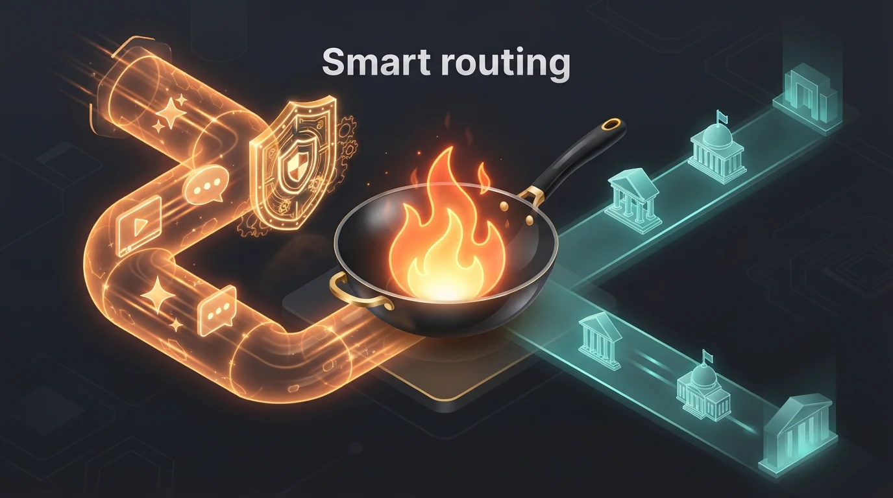

<div align="center">


# 🥡 Wokok VPN

### Your own unblockable VPN for Chrome — one command on the server, one on your PC.

**VLESS + Reality** that looks like ordinary HTTPS · **SSH fallback** · **Smart per-site routing** · **Leak protection**

[](LICENSE)
[](https://github.com/arsenikt/WokokVPN-Chrome/releases)


**English** · [Русский](README.ru.md) · [Website](https://arsenikt.github.io/WokokVPN-Chrome/)

</div>

---

## Why Wokok?

Commercial VPNs get blocked, sell your data and slow down everything, including your bank. Wokok runs on **your own $3/month server**, disguises itself as normal traffic to a big website, and only sends **the sites you want** through the tunnel.

| | Wokok VPN | Typical VPN extension |
|---|---|---|
| Your own server, your own keys | ✅ | ❌ shared IPs |
| Survives DPI (Reality looks like HTTPS to `microsoft.com`) | ✅ | ❌ |
| Banks & government sites stay direct | ✅ Smart mode | ❌ |
| WebRTC / DNS leak protection, kill switch | ✅ | sometimes |
| Same server works on your phone | ✅ `vless://` link + QR | ❌ |
| Price | your VPS | $5–12/mo |
| Open source, no telemetry | ✅ MIT | ❌ |

## ⚡ Quick start

### 1. Your server (Ubuntu / Debian / CentOS / Alma / Alpine)

```bash
curl -fsSL https://raw.githubusercontent.com/arsenikt/WokokVPN-Chrome/main/server/install.sh | sudo bash
```

About 30 seconds later you get a **`wokok://` link**, a **`vless://` link** and a **QR code**.

<details><summary>Options</summary>

```bash
# custom port / disguise site / name, no SSH fallback
curl -fsSL .../server/install.sh | sudo bash -s -- --port 8443 --sni www.apple.com --name "Frankfurt" --no-ssh
```
</details>

### 2. Your computer

**Windows** (PowerShell, no admin needed):
```powershell
irm https://raw.githubusercontent.com/arsenikt/WokokVPN-Chrome/main/client/install.ps1 | iex
```

**macOS / Linux:**
```bash
curl -fsSL https://raw.githubusercontent.com/arsenikt/WokokVPN-Chrome/main/client/install.sh | bash
```

This downloads the official [Xray-core](https://github.com/XTLS/Xray-core) and registers a tiny helper (PowerShell or Perl, so you don't need Node or Python). It also unpacks the extension.

### 3. Chrome

1. Open `chrome://extensions` → turn on **Developer mode**
2. **Load unpacked** → the folder the installer opened (`%LOCALAPPDATA%\WokokVPN\extension` on Windows)
3. Click the 🥡 wok → paste your `wokok://` link → **tap the wok**. 🔥

## ✨ Features



- 🧠 **Three modes.** *All sites*, *Smart* (only selected or blocked sites go through the VPN) and *All except* (everything except your bank list).
- 🎛 **Ready-made presets.** YouTube, Instagram, X, Discord, ChatGPT / Claude / Gemini, Facebook, LinkedIn, Telegram Web, Spotify / Netflix, dev tools.
- 📡 **Auto-updated blocklist.** The [antifilter community](https://community.antifilter.download/) list is refreshed every 6 hours.
- 🕵️ **Blocked-site detector.** When a page fails with `CONNECTION_RESET` or a timeout, Wokok offers *"Route via VPN?"* in one click.
- 🖱 **One-click site toggle.** From the popup, the right-click menu or **Alt+Shift+S**.
- 🛡 **Leak protection.** WebRTC is locked to the proxy, DNS is resolved on your server, and an optional **kill switch** keeps traffic from going direct if the tunnel drops.
- 🔁 **Self-healing.** A health check runs every minute plus on proxy errors, and the tunnel reconnects automatically.
- 🧯 **Reality → SSH fallback.** If Reality is blocked, the extension switches to an SSH tunnel through the same server.
- 🌍 **Multiple servers.** Pick one manually or let it auto-select the fastest. Includes a ping tester.
- 📊 **Popup dashboard.** Exit IP and country, real latency through the tunnel, a speed test, uptime and the current transport.
- ⌨️ **Hotkeys.** **Alt+Shift+V** turns the VPN on and off, **Alt+Shift+W** opens the popup.
- 👨‍👩‍👧 **Share with family.** `wokok add mom` creates a personal key and `wokok del mom` revokes it.
- 💾 **Backup and restore.** Export or import all settings as JSON.
- 🌐 **English and Russian** UI, picked automatically.

## 🧑‍🍳 Server cheat sheet

```bash
wokok add alice      # new key for a friend + link + QR
wokok del alice      # revoke
wokok list           # who has access
wokok link me        # show your link again
wokok status         # health check
wokok sni www.apple.com   # change disguise site
wokok update         # update Xray-core
wokok uninstall      # remove everything
```

## 🔬 How it works

```
Chrome ──PAC/proxy──► 127.0.0.1:10808 (xray, local SOCKS5)
                         │  VLESS + XTLS-Vision + Reality (looks like TLS to www.microsoft.com)
                         ▼
                    your server :443 ──► internet
        fallback:  ssh -D 10808 → wokok@server (port-forwarding only, no shell)
```

- **Extension (MV3).** Sets Chrome's proxy (a PAC script for Smart and Except modes) and talks to the helper over Native Messaging.
- **Helper.** `wokok-host.ps1` on Windows or `wokok-host.pl` on macOS/Linux. It starts `xray` or `ssh` as a detached process and checks that the tunnel really carries traffic (`generate_204` through the tunnel).
- **Server.** Xray Reality with a separate UUID per user. The SSH fallback user `wokok` is restricted to `restrict,port-forwarding` and has no shell or password.

## ❓ FAQ

<details><summary>Is it only for Chrome?</summary>
It works in any Chromium browser: Chrome, Edge, Brave, Vivaldi, Yandex Browser, Chromium. Only the browser is proxied, not the whole system. For the phone, use the <code>vless://</code> link in Hiddify, v2rayN, Streisand or NekoBox.
</details>

<details><summary>Which VPS should I buy?</summary>
Any VPS with 512 MB RAM outside your country works, for example Hetzner, DigitalOcean, Vultr or Aeza. Ubuntu 22.04/24.04 is recommended.
</details>

<details><summary>Port 443 is taken on my server</summary>
The installer automatically falls back to 8443. You can also pass <code>--port N</code>.
</details>

<details><summary>Uninstall</summary>

Server: `wokok uninstall`.
Windows: `$env:WOKOK_UNINSTALL=1; irm https://raw.githubusercontent.com/arsenikt/WokokVPN-Chrome/main/client/install.ps1 | iex`
macOS/Linux: `curl -fsSL https://raw.githubusercontent.com/arsenikt/WokokVPN-Chrome/main/client/install.sh | bash -s -- --uninstall`
</details>

<details><summary>Is it legal?</summary>
Wokok is a tool for private access to your own server. Follow the laws of your country.
</details>

## 🥡 Buy the author a wok


Wokok is free and always will be. If it saved your evening and you'd like to chip in **for a new wok** (the old one is overheating from all that traffic), here's the tip jar. A ⭐ works too!

| Network | |
|---|---|
| **EVM** (ETH · BSC · Polygon · Base · Arbitrum…) | `0x0aA2d41976f087763a354d598D32c21E1983CbFD` |
| **Solana** | `E1M7Ztc1MGnc587mmhk2dqBn2rWc4dXyx8huQ2HHpQjt` |
| **TRON** (USDT TRC-20) | `TXTrfbxAuy63ngzfWNiqubb2y2DHVqWbg9` |

<br clear="right">

## 🤝 Contributing

PRs are welcome. Good first issues: new presets, translations, Firefox port. If Wokok saved your evening, a ⭐ helps others find it.

## License

[MIT](LICENSE) · Built on [Xray-core](https://github.com/XTLS/Xray-core) (MPL-2.0), which is downloaded at install time and not bundled.
