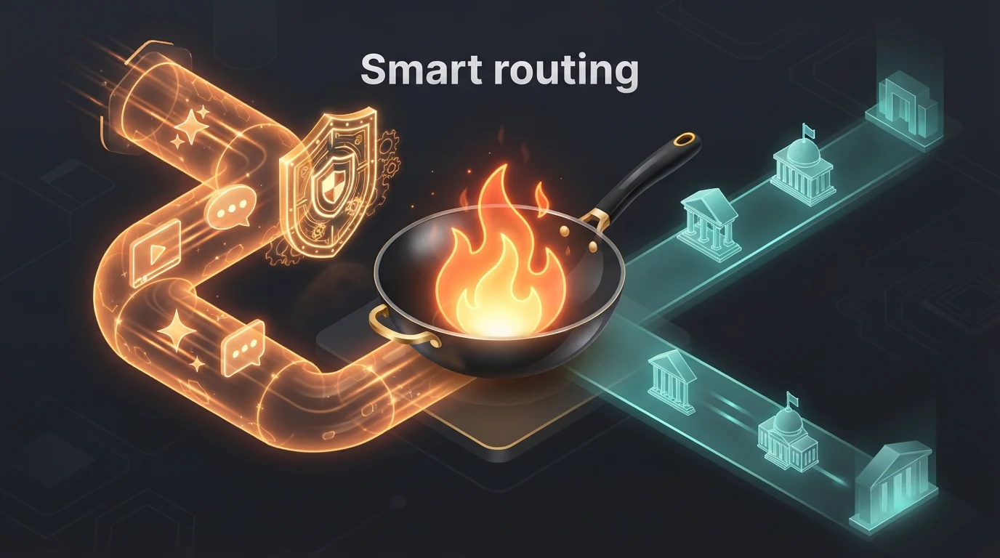

<div align="center">


# 🥡 Wokok VPN

### Свой неблокируемый VPN для Chrome: одна команда на сервере, одна на ПК.

**VLESS + Reality** выглядит как обычный HTTPS · **запасной SSH** · **умная маршрутизация по сайтам** · **защита от утечек**

[](#3-chrome)
[](https://github.com/arsenikt/WokokVPN-Chrome/releases/latest/download/wokok-extension.zip)


[](LICENSE)
[](https://github.com/arsenikt/WokokVPN-Chrome/releases)


[English](README.md) · **Русский** · [Сайт](https://arsenikt.github.io/WokokVPN-Chrome/)

</div>

---

## Зачем Wokok?

Коммерческие VPN блокируют, они продают данные и тормозят всё подряд, включая банк. Wokok работает на **вашем собственном сервере за 300 ₽ в месяц**, маскируется под обычный трафик к крупному сайту и пускает через туннель **только нужные сайты**.

| | Wokok VPN | Обычное VPN-расширение |
|---|---|---|
| Свой сервер, свои ключи | ✅ | ❌ общие IP |
| Переживает DPI (Reality выглядит как HTTPS к `microsoft.com`) | ✅ | ❌ |
| Банки и Госуслуги работают напрямую | ✅ Умный режим | ❌ |
| Защита от утечек WebRTC и DNS, kill switch | ✅ | иногда |
| Тот же сервер на телефоне | ✅ ссылка `vless://` + QR | ❌ |
| Открытый код, без телеметрии | ✅ MIT | ❌ |

## ⚡ Быстрый старт

### 1. Сервер (Ubuntu / Debian / CentOS / Alma / Alpine)

```bash
curl -fsSL https://raw.githubusercontent.com/arsenikt/WokokVPN-Chrome/main/server/install.sh | sudo bash
```

Примерно через 30 секунд вы получите **ссылку `wokok://`**, **ссылку `vless://`** и **QR-код**.

> 🔑 **Потеряли ссылку или закрыли терминал?** Её всегда можно получить снова на сервере:
> ```bash
> sudo wokok link          # ваша ссылка + QR
> sudo wokok link alice    # ссылка друга
> ```
> Все ссылки также сохранены в `/root/wokok-links.txt`.
>
> 🔧 **Что-то сломалось или нужна последняя версия?** Просто запустите ту же команду установки ещё раз. Она обновит `wokok`, починит конфиг (включая порт SSH в ссылках), сохранит все ключи и напечатает вашу ссылку.

<details><summary>Параметры</summary>

```bash
curl -fsSL .../server/install.sh | sudo bash -s -- --port 8443 --sni www.apple.com --name "Франкфурт" --no-ssh
```
</details>

### 2. Компьютер

**Windows** (PowerShell, права администратора не нужны):
```powershell
irm https://raw.githubusercontent.com/arsenikt/WokokVPN-Chrome/main/client/install.ps1 | iex
```

**macOS / Linux:**
```bash
curl -fsSL https://raw.githubusercontent.com/arsenikt/WokokVPN-Chrome/main/client/install.sh | bash
```

Установщик скачивает официальный [Xray-core](https://github.com/XTLS/Xray-core) и регистрирует маленький помощник на PowerShell или Perl, так что Node и Python не нужны. Он же распаковывает расширение.

### 3. Chrome

1. Откройте `chrome://extensions` → включите **Режим разработчика**
2. **Загрузить распакованное** → папка, которую открыл установщик (`%LOCALAPPDATA%\WokokVPN\extension` на Windows)
3. Нажмите на 🥡 вок → вставьте ссылку `wokok://` → **нажмите на вок**. 🔥

## ✨ Возможности



- 🧠 **Три режима.** *Все сайты* (по умолчанию: всё идёт через VPN), *Умный* (через VPN только выбранные и заблокированные сайты) и *Все, кроме* (всё, кроме банков).
- 🎛 **Готовые пресеты.** YouTube, Instagram, X, Discord, ChatGPT / Claude / Gemini, Facebook, LinkedIn, Telegram Web, Spotify / Netflix, инструменты разработчика.
- 📡 **Автообновляемый список блокировок.** [antifilter community](https://community.antifilter.download/) обновляется каждые 6 часов.
- 🕵️ **Детектор блокировок.** Если сайт отвалился с `CONNECTION_RESET` или по таймауту, Wokok предложит «Открыть через VPN?» в один клик.
- 🖱 **Сайт через VPN в один клик.** Из попапа, через правый клик по странице или **Alt+Shift+S**.
- 🛡 **Защита от утечек.** WebRTC привязан к прокси, DNS резолвится на сервере, а опциональный **kill switch** не пускает трафик напрямую, если туннель упал.
- 🔁 **Самовосстановление.** Проверка раз в минуту и при ошибках прокси, туннель переподключается автоматически.
- 🧯 **Reality → SSH.** Если Reality заблокировали, расширение переключается на SSH-туннель через тот же сервер.
- 🌍 **Несколько серверов.** Выбор вручную или автоматически самый быстрый, есть пинг-тест.
- 📊 **Дашборд в попапе.** IP и страна выхода, реальный пинг через туннель, тест скорости, время работы и текущий протокол.
- ⌨️ **Горячие клавиши.** **Alt+Shift+V** включает и выключает VPN, **Alt+Shift+W** открывает попап.
- 👨‍👩‍👧 **Для семьи и друзей.** `wokok add mama` выдаёт личный ключ, `wokok del mama` отзывает его.
- 💾 **Бэкап.** Экспорт и импорт всех настроек в JSON.
- 🌐 **Интерфейс на русском и английском**, язык выбирается автоматически.

## 🧑‍🍳 Шпаргалка по серверу

```bash
wokok add alice      # ключ для друга + ссылка + QR
wokok del alice      # отозвать
wokok list           # у кого есть доступ
wokok link           # снова показать ссылку + QR (также /root/wokok-links.txt)
wokok status         # проверка здоровья
wokok sni www.apple.com   # сменить сайт маскировки
wokok update         # обновить wokok + Xray-core до последней версии (ключи и ссылки сохраняются)
wokok update --check # только проверить, есть ли обновление
wokok sshport 5223   # указать реальный порт SSH в ссылках
wokok uninstall      # удалить всё
```

## 🔬 Как это работает

```
Chrome ──PAC/прокси──► 127.0.0.1:10808 (xray, локальный SOCKS5)
                          │  VLESS + XTLS-Vision + Reality (выглядит как TLS к www.microsoft.com)
                          ▼
                     ваш сервер :443 ──► интернет
        запасной путь: ssh -D 10808 → wokok@server (только проброс портов, без шелла)
```

## ❓ Вопросы

<details><summary>Только Chrome?</summary>
Работает в любом Chromium-браузере: Chrome, Edge, Brave, Vivaldi, Яндекс Браузер. Проксируется только браузер, а не вся система. Для телефона используйте ссылку <code>vless://</code> в Hiddify, v2rayN, Streisand или NekoBox.
</details>

<details><summary>Какой сервер купить?</summary>
Подойдёт любой VPS с 512 МБ RAM за пределами вашей страны, например Hetzner, Aeza, Vultr или DigitalOcean. Рекомендуется Ubuntu 22.04/24.04.
</details>

<details><summary>Расширение пишет «server port 443 is unreachable»</summary>
Порт закрыт файрволом хостера (в веб-панели провайдера, не на самом сервере). Откройте входящий <b>TCP 443</b> (или порт, который напечатал установщик, смотрите <code>sudo wokok status</code>) и повторите.
</details>

<details><summary>Порт 443 занят</summary>
Установщик сам переключится на 8443. Можно также указать <code>--port N</code>.
</details>

<details><summary>Удаление</summary>

Сервер: `wokok uninstall`.
Windows: `$env:WOKOK_UNINSTALL=1; irm https://raw.githubusercontent.com/arsenikt/WokokVPN-Chrome/main/client/install.ps1 | iex`
macOS/Linux: `curl -fsSL https://raw.githubusercontent.com/arsenikt/WokokVPN-Chrome/main/client/install.sh | bash -s -- --uninstall`
</details>

<details><summary>Это законно?</summary>
Wokok — инструмент для приватного доступа к собственному серверу. Соблюдайте законы своей страны.
</details>

## 🤝 Участие

PR приветствуются: новые пресеты, переводы, порт под Firefox. Если Wokok вас выручил, поставьте ⭐, так проект найдут другие.

### 🥡 На покупку вока

Бесплатно навсегда. Если Wokok выручил, киньте монетку в вок, а то старый уже перегревается от трафика.

- **EVM** (ETH · BSC · Base · Polygon): `0x0aA2d41976f087763a354d598D32c21E1983CbFD`
- **Solana**: `E1M7Ztc1MGnc587mmhk2dqBn2rWc4dXyx8huQ2HHpQjt`
- **TRON** (USDT TRC-20): `TXTrfbxAuy63ngzfWNiqubb2y2DHVqWbg9`

## Лицензия

[MIT](LICENSE) · Использует [Xray-core](https://github.com/XTLS/Xray-core) (MPL-2.0), он скачивается при установке и не входит в репозиторий.
